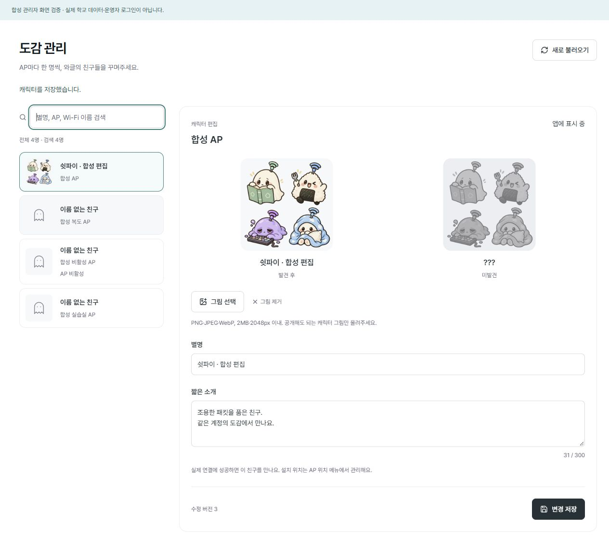

# 캐릭터 관리와 계정 도감

2026-10-30 기준 관리자 캐릭터 화면과 앱용 도감·수집 API를 구현했다. 앱에서 OS 연결을 관찰해 보고하는 기능과 오프라인 보호 대기열은 네이티브 단계에서 연결한다. 서버 테스트나 관리자 미리보기가 실제 학교 연결·도감 해금의 증거는 아니다.

## 저장소 이전

기존 학교 DB와 일반 사용자 DB·각 키를 함께 백업한 뒤 다음 명령을 실행하고 서버를 다시 시작한다. 서로 다른 DB·키를 섞거나 기존 키를 새로 만들지 않는다.

```sh
npm run settings:migrate
npm run members:migrate
```

학교 user_version과 일반 사용자 native_meta.schema_version을 각각 1→2로 명시적으로 올린다. 기존 학교 암호문·AP·개인 코드·기기 세션을 보존하고 같은 명령을 다시 실행할 수 있다. 요청 중에는 이전하지 않으며, 스키마가 준비되지 않았으면 안전한 설정 대기·오류를 표시한다. v1 프로그램으로 되돌리는 경우에는 백업과 프로그램을 함께 복원해야 한다.

학교 DB에는 school_character(AP별 한 행)와 school_art(재인코딩된 이미지)를 둔다. 일반 사용자 DB에는 native_collection(member_id, ap_id) 집합만 둔다. 수집마다 접속 시각·기기·방문 횟수·위치 경로를 기록하지 않는다.

## 관리자 사용

도감 관리 메뉴에서 AP를 선택하고 별명·소개·그림을 편집한다. AP 한 항목은 BSSID 하나이며 캐릭터도 하나다. 편집 전에는 이름 없는 친구·그림 없음으로 표시한다. 실제 학교용 이름·그림·AP를 자동 생성하지 않는다.

PNG/JPEG/WebP, 2MiB·2048×2048px 이하의 정지 그림만 받는다. 픽셀 수·파일 서명·MIME·프레임·정상 base64를 검사하고, 최대 1024px WebP로 변환하며 메타데이터를 제거한다. 출력 한 장은 최대 1MiB, 자산 합계는 128MiB다. 쓰지 않는 이전 자산은 트랜잭션 안에서 제거한다. 여러 캐릭터가 같은 그림을 사용하면 공유 참조를 유지한다.

텍스트·그림은 수정 버전을 다시 확인한 뒤 함께 저장한다. 다른 창의 저장과 충돌하면 현재 입력을 유지하고 최신 목록을 다시 불러오도록 안내한다. 새로 불러오기나 다른 AP 선택은 편집 중인 내용을 바꾸므로 저장 후 이동한다. 비활성 AP도 관리자에게 보이며 앱 목록과 새 수집 대상에서는 제외된다. 이미 수집한 집합은 남아 재활성화하면 복원된다.

그림은 /api/art/콘텐츠해시에서 공개되므로 개인정보·학교 접속정보·설치 도면을 올리지 않는다. 이 경로는 DB에 저장된 WebP만 고정 MIME·nosniff·불변 캐시로 제공한다. 참조가 사라진 예전 URL은 더 이상 제공되지 않을 수 있다.

## 앱 API

| 경로                              | 접근                         | 결과                                                                   |
| --------------------------------- | ---------------------------- | ---------------------------------------------------------------------- |
| GET /api/client/encyclopedia      | 현재 일반 사용자 Bearer 세션 | schemaVersion=1, 설정 version, 활성 AP 캐릭터의 id·별명·소개·그림 경로 |
| GET /api/client/collection        | 같은 세션                    | 본인 계정의 수집 AP ID 집합                                            |
| POST /api/client/collection       | 같은 세션                    | 현재 연결 보고를 중복 없이 합친 본인 집합                              |
| GET /api/admin/characters         | 운영자 세션                  | 전체 AP의 편집용 캐릭터 목록                                           |
| PATCH /api/admin/characters/AP ID | 운영자 세션·동일 Origin      | 수정 버전과 텍스트·선택적 그림 저장                                    |

도감·수집 요청은 기기마다 합계 60회/5분이다. 일반 사용자 API는 쿠키·갱신 토큰·운영자 인증으로 대신할 수 없으며, 매번 현재 코드·기기 세션의 회수·만료를 확인한다. 조회는 private/no-store이며 계정·시각을 쿼리나 본문에서 선택할 수 없다. 앱 도감에는 지도·설치 장소·SSID·BSSID를 포함하지 않는다. 접속 엔진은 별도의 학교 설정 API를 사용한다.

POST는 reports 배열에 OS가 실제 연결을 확인한 apId·정확한 ssid·bssid만 최대 100개 보낸다. 현재 활성 AP·부모 네트워크와 모두 일치해야 하며 하나라도 틀리면 전체를 저장하지 않는다. 본문은 16KiB, 수집 집합은 계정당 10,000개, 도감 응답은 4MiB로 제한한다. 중복 보고는 새 방문 기록을 생성하지 않는다. 서버는 앱 보고를 검증하지만 무선 접속 자체를 독립적으로 증명하지 않는다.

같은 내부 계정의 휴대폰·노트북은 이 집합을 공유한다. 별도 계정의 이름·이메일이 같다고 합치지 않는다. 앱은 검색·연결 요청·실패를 보고하거나 도감을 위해 강제 전환하면 안 된다. 로그아웃 시 보호 대기열도 해당 계정과 함께 정리하도록 클라이언트 단계에서 연결한다.

## 검증

실제 SQLite·인증 서비스로 두 기기 공유·다른 계정 격리·중복·회수·활성 연결 일치·본문 제한·집합 상한 롤백을 검사했다. 학교/사용자 v1 이전과 이미지 형식 위장·큰 치수·다중 프레임·동시 수정·메타데이터 제거를 검사한다. `npm run check`, `npm run build`를 실행한다.

실제 React 컴포넌트와 관리 HTTP·메모리 DB를 연결한 합성 화면에서 텍스트·그림 저장, 검색 없음·AP 미등록, 1280px/390px 배치와 이미지 로드를 확인했다. 합성 운영자 권한 어댑터를 사용한 별도 로컬 검증 서버이며 제품 인증을 우회하는 기능은 없다.


