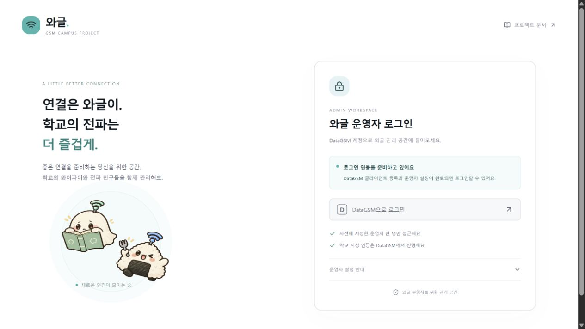

# DataGSM 운영자 인증 검토와 검증

관련 이슈: [#2](https://github.com/sunwoo162/waggle/issues/2) · PR: [#13](https://github.com/sunwoo162/waggle/pull/13)

## 범위와 결과

운영자 웹의 DataGSM PKCE 로그인, 한 명의 계정 ID 허용, 영속 SQLite 세션, 로그아웃과 서버 접근 보호를 구현했다. DataGSM 클라이언트는 아직 등록하지 않았으므로 실제 사람 계정 로그인은 검증 전이다. 네이티브 앱 로그인 복귀와 학생 세션이 남아 있어 이 PR로 이슈 #2를 닫지 않는다.

## 독립 코드 리뷰

별도 컨텍스트의 AI 리뷰어가 cc96658부터 d1abd79까지 읽기 전용으로 검토했다. 실제 구현 파일, 페이지·API 가드와 설치된 Better Auth의 callback·state·계정·세션 코드를 확인하고 인증 흐름·HTTP·정책 테스트 18개를 독립 실행했다. 모두 통과했으며 치명적·중요·경미한 수정 사항은 발견하지 않았다. 인간 협업자의 승인으로 표시하지 않는다.

처음 요청한 리뷰는 모델 사용량 제한으로 결과 없이 중단됐다. 대체 리뷰 한 건을 완료했으며 위 결과는 대체 리뷰의 결과다.

## 구현 판단과 경계

1. Better Auth가 state·PKCE·쿠키·CSRF를 담당하고 DataGSM의 JSON 교환만 어댑터로 연결했다. DataGSM ADMIN 값은 와글 권한이 아니며 신규·재로그인 모두 지정된 최상위 계정 ID와 ACTIVE 상태를 확인한다.
2. 세션은 DB에서 확인하고 8시간 후 만료된다. 쿠키 세션 캐시와 자동 연장은 끈다. 외부 계정 상태 변경을 기존 세션에 실시간 전파하는 연동은 후속 범위다.
3. SQLite는 단일 영속 Node 서버용이다. 다중 인스턴스·일회성 파일 시스템 배포를 완료했다고 판단하지 않는다. 요청 중 마이그레이션하지 않으며 DB·환경 파일을 빌드 추적에서 제외한다.
4. 공개 기획 문서는 기존처럼 공개한다. /admin layout·각 페이지·관리 API는 독립적으로 서버 권한을 검사한다. 인증 우회용 데모 계정·API는 제공하지 않는다.
5. 실제 제공자 문서는 브라우저에서 확인했다. 합성 제공자 테스트는 공식 계약을 검증하지만 등록된 클라이언트와 실제 계정의 상호운용성을 보증하지 않는다.

## 검증 근거

- `npm run check`: 테스트 29개, 저장소 비밀 파일 검사, 공개 문서 13개·화면 34개·링크 153개, Biome·TypeScript 검사 통과.
- `npm run build`: Next.js production build 통과. 파일 추적 목록 10개에 환경 파일·실제 DB 경로가 없음을 확인했다.
- GitHub Actions quality: Ubuntu의 의존성 설치 → 문서 재생성 일치 → check → build 통과. 최신 상태는 PR의 Checks에서 확인한다.
- 실제 로컬 HTTP: 미로그인 /admin·/admin/documents는 307, 설정 없는 관리 세션·로그인 시작은 503, 토큰 반환 경로는 404, 잘못된 로그아웃 메서드는 405, 공개 문서는 200을 확인했다.
- 브라우저: 설정 없음 안내·비활성 로그인, 운영자 안내 펼치기, 데스크톱과 375px 화면을 확인했다. 실제 DataGSM 로그인 버튼의 성공 흐름은 아직 확인하지 않았다.

개발 중 네이티브 redirect의 변경 불가 Headers, @next/env의 CJS import, 제공자의 error_description 반영 문제를 각각 실패 테스트로 재현한 뒤 수정했다. 해당 회귀 테스트는 29개에 포함된다.

최종 브라우저 확인에서는 Windows의 localhost 실행이 IPv6에만 바인딩되어 IPv4 접속이 실패했다. dev·start의 수신 인터페이스를 127.0.0.1로 고정하고 localhost 브라우저 접근을 다시 확인했다. OAuth origin과 등록 콜백은 localhost로 유지한다. 이 실행 설정 조정은 독립 리뷰 이후에 확인·반영했다.

## 다음 외부 검증

[인증 설정 안내](../datagsm-auth.md)에 따라 DataGSM 클라이언트와 운영자 계정 ID를 설정한 뒤 실제 계정 인증·취소·로그아웃을 확인한다. 로컬 콜백은 `http://localhost:3000/api/auth/callback/datagsm`이다. 실제 등록 화면의 localhost 허용 여부와 운영 HTTPS 쿠키·콜백은 해당 환경에서 별도로 확인한다.
