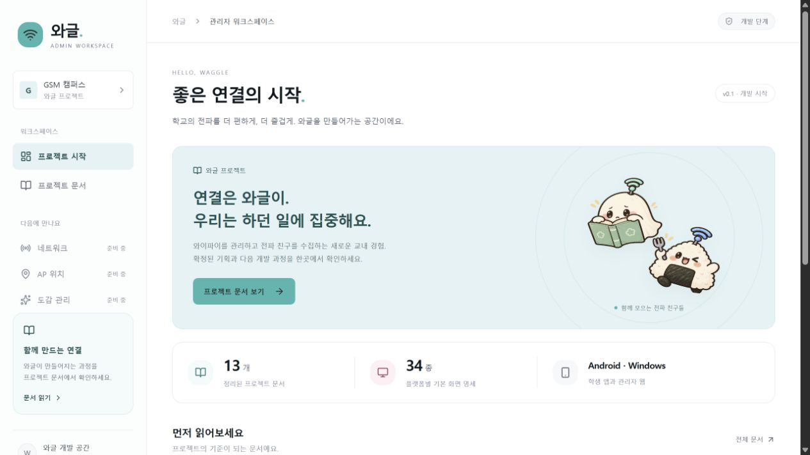
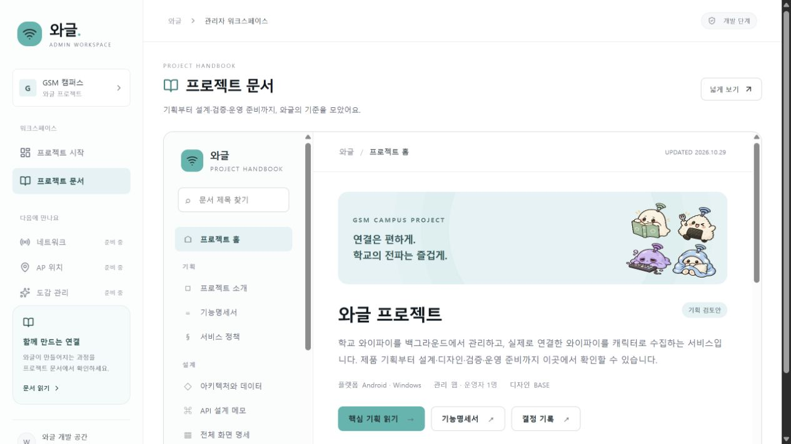

# 개발 기반 검토와 검증

관련 이슈: [#1](https://github.com/sunwoo162/waggle/issues/1) · PR: [#8](https://github.com/sunwoo162/waggle/pull/8)

## 범위

와글 공개 저장소의 작업 안내·훅·CI, 이식 가능한 기획 문서, 관리자 시작 화면과 프로젝트 문서 메뉴다. 실제 인증·학교 접속정보 저장·Android·Windows 앱은 후속 이슈 #2–#7이다.

## 독립 코드 리뷰

별도 컨텍스트의 AI 코드 리뷰가 기반 커밋 afbc641부터 6ae26f8까지 읽기 전용으로 확인했다. 인간 협업자의 승인으로 표시하지 않는다.

| 발견                                           | 재현                                                    | 수정                                                |
| ---------------------------------------------- | ------------------------------------------------------- | --------------------------------------------------- |
| 원본에서 지운 문서가 공개 복사본에 남음        | 두 번째 준비 후 삭제된 파일이 여전히 존재해 테스트 실패 | 허용된 원본 목록과 관리 출력 대조, 오래된 파일 정리 |
| 원문 링크만 검사해 공개 제외 자료의 404를 놓침 | 공개하지 않는 계획 파일을 링크하는 fixture              | 문서 준비 후 실제 공개 트리를 검사, 없는 대상 거부  |

중요 발견 2개를 한 차례 수정했다. 치명적 발견과 미룬 경미한 발견은 없었다. 수정 후 동작 테스트, 문서·저장소·Biome·타입 검사와 production build를 실행했다.

## 이번에 내린 구현 판단

1. 사용자의 개발 시작 지시를 기존 제품 기획의 구현 승인으로 적용했다. 미확정 도감 공유는 제안 상태로 유지했다. 범위를 잘못 넓히면 원치 않는 기능이 생기므로 이번 PR은 기반·문서 화면으로 한정했다.
2. 새 저장소의 작업 브랜치에서 개발했다. 기존 구현 작업과의 충돌이 없으므로 별도 worktree는 만들지 않았다. 작업 디렉터리는 PR 후속 수정용으로 유지한다.
3. Node/npm이 준비된 환경에서 추가 패키지 관리자 없이 실행하도록 npm workspaces를 사용했다. 워셔의 pnpm 명령과는 다르며, 네이티브 앱은 각 플랫폼 빌드 체계를 사용한다.
4. Biome 마이그레이션 결과에서 꺼진 규칙을 발견해 recommended preset을 명시했다. 서로 다른 컴포넌트 선택자의 순서를 비교하는 noDescendingSpecificity만 제외했다. 해당 선택자의 실제 충돌은 화면·코드 리뷰로 확인해야 한다.
5. 문서 출력 정리는 public/project-docs에만 허용하며 경로와 심볼릭 링크를 검사한다. 이 디렉터리는 전부 생성 자료이므로 수동 파일을 보관하지 않는다.

## 검토에서 미룬 범위에 대한 판단

- 인증·암호화·네이티브 연결·해금: 코드가 없는 기능이며 현재 동작한다고 표시하지 않는다. 후속 PR에서 각각 검증한다.
- 외부 계정·배포·GitHub 설정: 운영 배포와 외부 서비스 생성은 이번 구현 범위에 없다. GitHub의 main 보호와 필수 quality 검사는 실제 API 응답으로 별도 확인했다.
- 외부 제공자·플랫폼 API 정확성: 아직 연동 코드가 없다. 공식 자료와 실제 기기의 동작을 다음 검증의 근거로 사용한다.

## 확인 명령과 화면

- `npm run check`: 동작 테스트 8개, 비밀 파일·토큰 검사, 공개된 13개 문서·34개 화면·152개 링크, Biome·타입 검사.
- `npm run build`: Next.js production build.
- GitHub Actions: 새 Ubuntu 환경에서 npm ci → 문서 재생성 일치 → check → build.
- 브라우저: 데스크톱·작은 화면, 시작 화면에서 문서 이동, 문서 목차·기능명세 확인.

