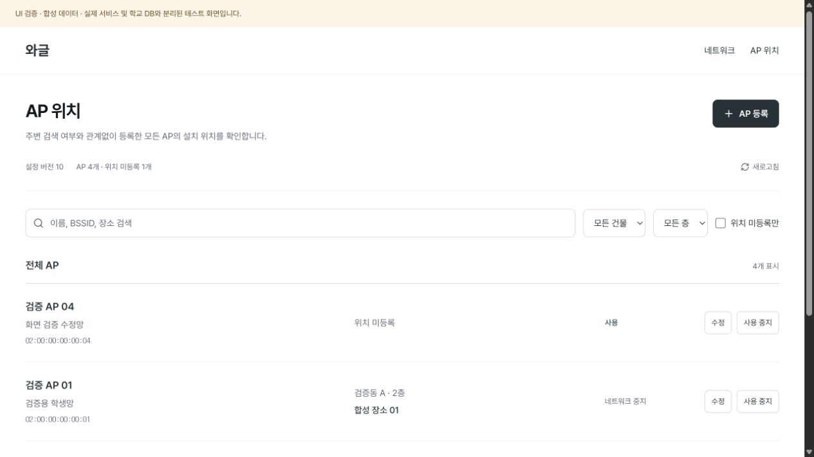
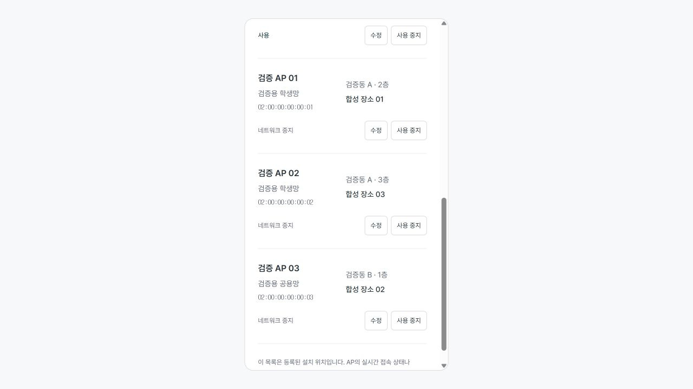

# 학교 네트워크·AP 관리 검토와 검증

관련 이슈: [#3](https://github.com/sunwoo162/waggle/issues/3). 기반은 운영자 인증 PR #13이 병합된 737ee2e다.

## 구현 범위

운영자 전용 네트워크·전체 AP 등록/수정/사용 중지, 설치 위치·미등록 위치 조회, 비밀번호 암호화 저장과 설정 버전이다. 같은 SSID의 여러 연결 프로필을 허용하며 AP는 프로필과 별도로 저장한다. 네트워크 사용 중지 시 AP 위치 기록을 유지한다.

## 독립 리뷰

별도 컨텍스트의 AI 리뷰어가 737ee2e..a7adf9d를 읽기 전용으로 확인하고 학교 테스트 14개를 독립 실행했다. 인간 협업자의 승인으로 표시하지 않는다.

| 발견                                        | 근거                                                                                                         | 처리                                                                                                               |
| ------------------------------------------- | ------------------------------------------------------------------------------------------------------------ | ------------------------------------------------------------------------------------------------------------------ |
| 중요: 키 준비 명령이 기존 키를 놓칠 수 있음 | dotenv의 공백 또는 export 문법으로 작성한 키가 있으면 새로운 키를 추가하는 현상을 실제 @next/env 파서로 재현 | 실패 회귀 테스트 추가 후 dotenv.parse와 할당문/중복 검사로 기존 값 보존. 공백·export·따옴표·콜론·중복·빈 값을 검사 |

치명적·경미한 발견은 없었다. 중요 발견 한 건을 한 차례 수정하고 회귀 테스트와 전체 검사를 실행했다. 새 파서는 환경을 process.env에 주입하거나 값을 출력하지 않는다.

## 자동 검증

- 전체 테스트 44개. 저장소·문서·Biome·TypeScript와 production build 검사.
- GCM nonce·AAD·tag·키 변조, DB의 암호문 저장과 DTO 원문/암호문 미반환.
- 명시적 스키마 준비·반복 migration·SQLite 재개방·잘못된 키 거부.
- SSID 바이트·깨진 Unicode·암호 형식·BSSID 중복·부모/위치·revision 충돌과 버전 원자성.
- 관리 API의 인증 실패·Origin·JSON·실제 본문 크기·메서드·안전한 오류. 인증 실패 시 저장소를 열지 않음.
- 건물·층·누락 위치·SSID/BSSID/장소 검색. 비활성 항목도 등록 목록에서 유지.
- 빌드 파일 추적 목록 13개에서 환경 파일·실제 학교 DB 경로가 없음을 확인. 동적 경로 추적 경고는 runtime 경로의 ignore 주석으로 해결.

## 브라우저 확인

실제 SchoolManager·입력 컴포넌트를 분리된 합성 자료·메모리 SQLite에 연결해 조작했다. 해당 일회성 검증 도구는 .superpowers/에만 있고 제품 빌드에 포함하지 않는다. 실제 학교 환경 파일·DB·DataGSM 세션을 사용하지 않으며 화면에 합성 검증 표시를 붙였다.

네트워크 추가 → 목록·버전 갱신 → 빈 비밀번호로 수정 → 사용 중지, AP 등록 → 위치 수정 → 필터 갱신, BSSID 검색과 건물/층 필터, 중복 저장 거부와 입력 유지, 375px 목록을 확인했다. 합성 제공자/권한 fixture를 실제 로그인 검증으로 표시하지 않는다. 제품 관리 경로에는 인증 우회 코드를 넣지 않았다.

## 외부 검증과 후속 범위

DataGSM 클라이언트 등록 후 실계정 → 관리 화면 → 실제 학교 설정 등록을 확인해야 한다. 교내 SSID/BSSID와 위치 정보, Enterprise·캡티브 인증, 도면, 일반 사용자 설정 배포·기기 연결·도감 매핑은 이번 완료 범위에 포함하지 않는다. [저장소 운영 안내](../school-settings.md)에 초기 지원과 키·DB 복구 경계를 기록했다.
