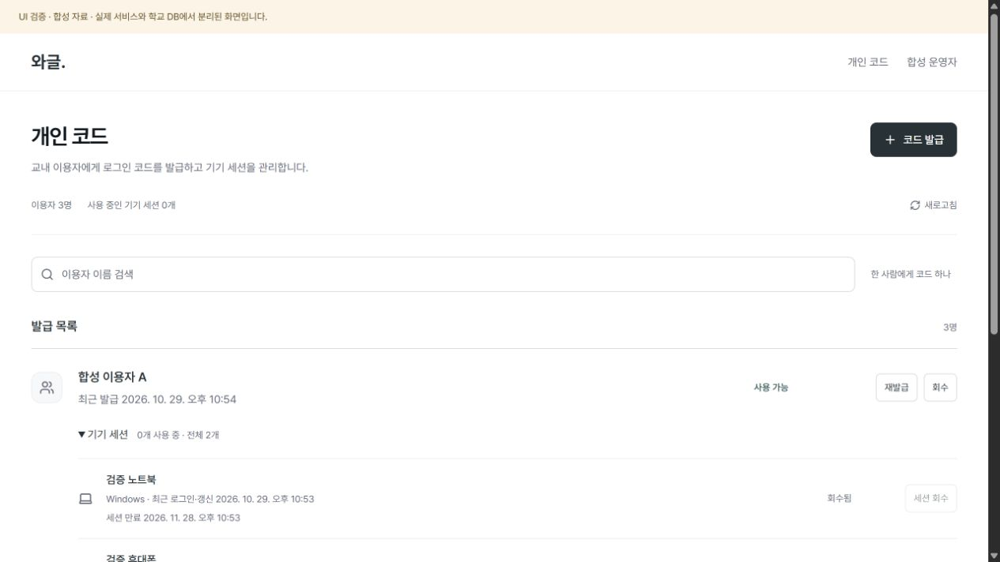

# 개인 코드·기기 세션 검토

검토일: 2026-10-30. 구현자는 현재 작업 에이전트, 별도의 읽기 전용 리뷰는 invite_final_review가 수행했다. 실제 협업자나 학교 검증을 가정하지 않는다.

## 범위와 결과

최초 검토 범위는 772b1cd..2214ecd다. 개인 코드만으로 로그인, 별도 일반 사용자 인증 DB·라이브러리, 기기 갱신·회수, 관리자 UI와 HTTP 경계를 확인했다. 리뷰는 Critical·Important 없음, Minor 한 건으로 판정했다. 지정 서비스·HTTP·설정 테스트 16개가 통과했다.

발견: 발급 요청 후 화면이 숨겨졌다가 복귀한 다음 늦은 응답이 오면 코드 원문을 다시 표시할 수 있었다. 구현자는 일시적 자격증명 표시 약속을 위반하므로 수정 대상으로 높였다. visibilitychange의 숨김·pagehide·unmount 때 세대값을 변경하고 요청 시점과 일치하며 현재 보이는 화면에만 코드 원문을 표시하도록 수정했다. 숨겨진 발급 결과는 목록에 반영하되 원문을 표시하지 않고 재발급 방법을 안내한다.

실제 InviteManager와 실제 관리 HTTP·메모리 SQLite를 사용한 분리된 브라우저 검증에서 응답을 보류하고 visibilitychange를 합성했다. 제품 라우트에 검증 제어 기능은 추가하지 않았다.

1. 코드 발급 요청 후 성공 응답을 보류한다.
2. 탭 숨김과 복귀 이벤트를 합성한다.
3. 늦은 응답을 전달한다.
4. 수정 전 원문이 다시 표시되는 실패를 확인했다. 수정 후 원문 부재와 재발급 안내를 확인했다.

검증의 visibility 이벤트는 합성이며 실제 브라우저·OS 절전 정책 검증으로 표시하지 않는다. 코드 원문은 AX 출력에서 제외했고 코드가 표시된 화면은 캡처하지 않았다. 서버 자동 검사 60개와 전체 check/build를 통과시킨 뒤 PR의 현재 커밋 CI도 확인한다.

## 판단과 외부 조건

- 기존 순차 체크아웃을 작업 브랜치에서 재사용했다. 구현 작업자가 동시에 파일을 수정하지 않는 조건이다. 이 조건이 바뀌면 별도 격리가 필요하다.
- 이전 정리 작업의 자동 승인 거절에 따라 무시된 검증 파일을 보존했다. 제품 코드·공개 자료에 포함하지 않으며 다른 삭제 방식으로 우회하지 않았다.
- 코드 표시 경합은 리뷰의 Minor 판정보다 높여 수정했다. 미수정 시 운영자가 숨겼다고 믿은 코드가 다시 노출될 수 있다. 수정 때문에 응답을 놓쳤다면 재발급이 필요하며 UI에 안내한다.
- 실제 DataGSM·Android·Windows·교내 Wi-Fi는 후속 검증이다. 현재 결과는 그 동작을 보증하지 않는다.
- 전교 동시 접속에서 요청 제한의 적정성은 실측이 필요하다. 초기 전역 제한은 대량 로그인 때 정상 요청도 지연시킬 수 있다.
- 회수된 프레임워크 행은 즉시 물리 삭제하지 않아도 메타데이터가 모든 접근·갱신을 거부한다. 저장 공간 관리·보존 기간은 운영 전 정할 항목이며 인증 검사를 생략하면 이 판단은 성립하지 않는다.
- 리뷰어는 배치·반응형을 직접 재검증하지 않았다. 구현자가 분리된 합성 UI에서 발급·복사·숨김·재발급·기기 회수·전체 코드 회수·수정 충돌·375px 배치를 확인했다.

보류한 Minor는 없다. 학교 이메일 인증·DataGSM 네이티브 복귀·OS 보안 저장·학교 설정 배포는 이번 PR에 포함하지 않으므로 #4를 닫지 않는다.

