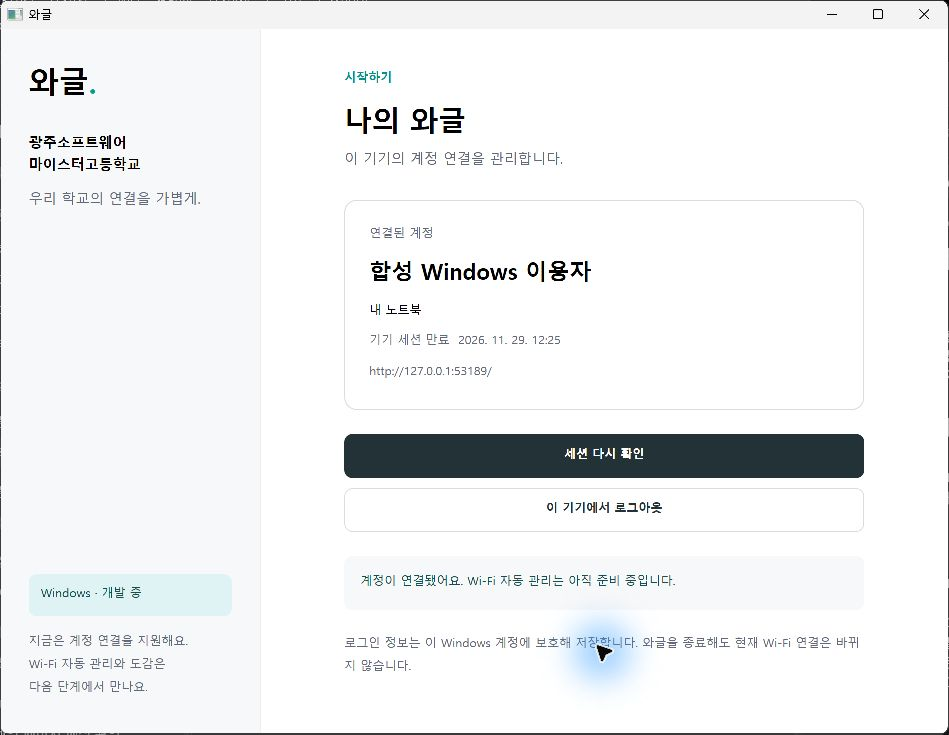

# Windows 계정 앱 검토

별도 읽기 전용 windows_final_review가 150ef4c..e8462f4를 검토했다. 구현자는 본 작업 에이전트이며 실제 협업자·학교 실사용을 가정하지 않는다. 리뷰어의 지정 Release 테스트는 11/11 통과했다.

## 발견과 수정

Critical은 없고 Important 두 건을 한 번의 수정 과정에서 처리했다.

1. 서버 접속과 로컬 삭제가 모두 실패하면 파일은 남지만 삭제 재시도 경로가 사라졌다. 실패 테스트 후 인증은 해제한 채 명시적인 삭제 대기 상태와 재시도 버튼을 유지하도록 수정했다. 대기 중 인증 재사용은 금지한다. 첫 저장·삭제가 모두 실패한 경우도 확인했다. 삭제 실패 중 앱 재실행 시 계정이 복원될 수 있다는 실제 한계를 안내한다.
2. 재실행에서 복원한 서버가 입력란에 반영되지 않아, 만료·회수·로그아웃 뒤 localhost로 돌아갔다. 실패 테스트 후 유효한 origin을 토큰과 별도로 메모리에 유지하고 초기 복원 성공·실패 모두 입력란에 반영했다. 로그아웃 후 주소를 별도 디스크 파일에 남기지는 않는다.

회귀 검사는 삭제 실패·재시도·인증 재사용 금지, 첫 저장/삭제 실패, 만료·로그아웃 후 origin 유지, 실제 Windows의 잠긴 파일 삭제 실패·잠금 해제 후 삭제를 포함한다. 기존 결함의 RED와 수정 후 GREEN을 확인했다. 별도 재리뷰는 수행하지 않았다.

## 직접 확인한 흐름

실제 WPF를 서버의 실제 MemberService·HTTP·메모리 DB에 연결했다. 합성 로그인으로 DPAPI 파일 생성, 종료·재실행 복원, 접근 토큰 거부 뒤 복구, 503 상태 보존·복구, 로그아웃·파일 제거, 재로그인 후 코드 회수·파일 제거를 확인했다. 실제 사람·DataGSM·교내 Wi-Fi가 아니며 제품에 합성 인증 우회는 없다.

실행 중인 앱의 DLL 잠금 때문에 검증 앱을 닫고 최종 빌드·검사를 수행했다. 문서 생성의 일시적인 OS 파일 열기 실패는 재실행으로 복구하고 생성물을 반영했다.

## 판단과 남은 검사

- .NET 10 LTS·WPF를 선택했다. .NET 8은 지원 종료가 가까워 새 앱 기반으로 사용하지 않았다. 공식 SDK는 무시된 프로젝트 로컬 경로에만 준비했다. 개발자는 SDK·Windows 환경이 필요하다.
- 기존 순차 체크아웃을 기능 브랜치에서 재사용했다. 동시 구현자가 없었으며 병렬 작업 때는 격리가 필요하다.
- 숨김 셸 재실행이 자동 승인에서 차단됐을 때 제공된 앱 실행 도구를 사용했다. 다른 사용자 프로세스·보안 설정은 바꾸지 않았다. 빌드 잠금 정리 시 직접 시작한 앱의 정확한 실행 경로를 확인했다.
- 실제 학교·DataGSM·Android·전체 #4/#5, 설치·서명·업데이트·Windows 11 이외 환경은 후속이다. 현재 구현으로 성공을 보증하지 않는다.
- 같은 사용자·같은 터미널 세션의 단일 인스턴스를 적용했다. 다른 터미널 세션 간 뮤텍스는 독립 재현하지 않았다. 여러 세션 지원에는 공용 파일·토큰 경합 검증이 필요하다.
- 리뷰어는 WPF 빌드·시각 조작·전체 웹 검사를 직접 반복하지 않았다. 구현자가 근거를 수집했고 비밀 환경 파일·실제 사용자 세션을 리뷰 자료로 제공하지 않았다.

보류한 Minor 한 건: 현재 큰 응답 검사는 text/plain 거부를 먼저 지나며, 사용자 지정 핸들러의 302 검사는 실제 기본 핸들러의 리디렉션 미추적을 증명하지 않는다. 구현에는 JSON 스트림 크기 제한·리디렉션 금지가 있지만, Content-Length 없는 큰 JSON과 실제 HTTP 리디렉션 통합 검사는 추가할 항목이다. 인증 코드 결함으로 판정하지 않았다.

