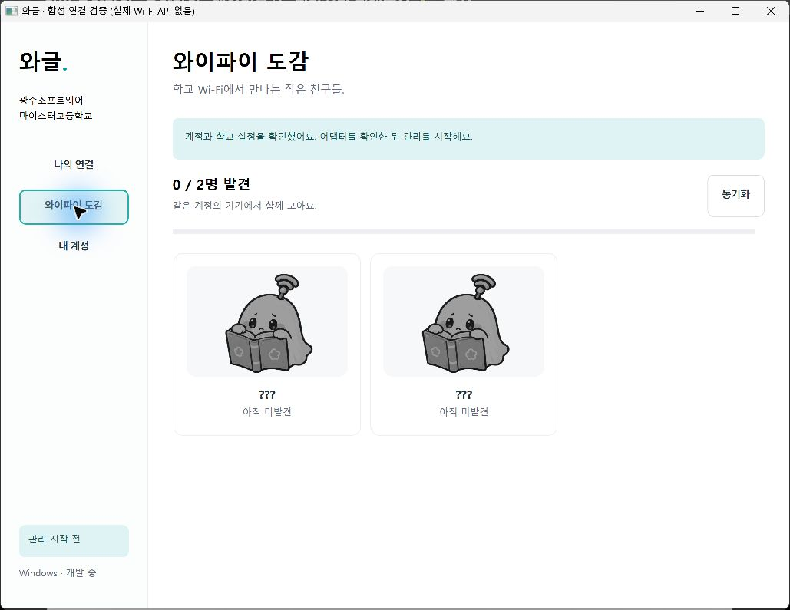
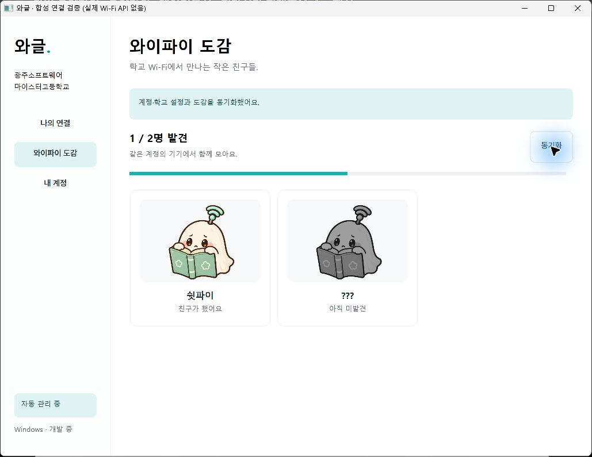

# Windows 자동 관리와 그림 도감

GSM 사용자용 .NET 10·WPF 앱이다. 관리자는 웹을 사용하며 사용자 앱에 지도·도면·AP 설치 장소를 제공하지 않는다.

## 시작과 종료

개인 코드 로그인 후 어댑터를 확인하고 학교 접속정보 저장·연결 요청에 동의한 뒤 관리 시작을 누른다. 로그인·재실행만으로 관리를 시작하지 않는다. 관리 중 창 닫기는 트레이로 숨기며 트레이에서 다시 열기·일시 중지·종료를 제공한다. 일시 중지·로그아웃·종료는 현재 Windows 연결을 끊지 않는다. 부팅 자동 시작은 구현하지 않았다.

같은 Windows 사용자에 대해 터미널 세션 간에도 Global 이름의 mutex를 사용한다. 다른 사용자는 별도 인스턴스와 CurrentUser 보호 자료를 사용한다. 실제 복수 터미널 세션 조합은 현장 검증 조건이다.

## 관찰과 연결 요청

관리 중 10초 간격으로 현재 연결과 BSS 후보를 관찰한다. 명시적 스캔 요청은 60초 간격보다 자주 하지 않는다. 등록 SSID·BSSID와 보안 방식이 일치하는 최근 90초 후보만 사용한다. 다른 Wi-Fi를 사용 중이면 유지한다.

학교 연결이 35% 미만으로 3번 연속 관찰되고, 45% 이상이면서 15%p 이상 나은 후보가 있으면 요청한다. 미연결 상태는 유효한 후보를 시도한다. 요청 간 60초, 확인 대기 30초, 실패 후보 제외 5분을 적용한다. 신호 품질은 속도 측정값이 아니다.

서비스 origin과 네트워크 ID에서 만든 Waggle 프로필만 per-user·수동 연결 모드로 등록한다. 일반 프로필을 열거·삭제하거나 우선순위를 바꾸지 않는다. WPA3 요청 실패를 WPA2로 낮추지 않는다. 프로필 XML은 메모리에서 구성하며 파일·로그에 남기지 않는다. Windows 위치 서비스·데스크톱 앱 접근·학교 정책과 드라이버의 거부를 우회하지 않는다.

## 수집과 보호 저장

OS 현재 연결의 정확한 SSID·BSSID·보안 방식이 등록 AP와 맞아야 수집한다. 요청 접수·스캔·확인 시간 초과는 수집이 아니다. AP 한 항목에 캐릭터 하나이며 같은 내부 계정의 휴대폰·노트북은 수집 집합을 공유한다.

수집과 보고 대기열을 origin·member ID에 묶인 DPAPI 파일에 먼저 저장한다. 현재 설정과 맞는 보고를 한 번에 최대 50개 전송한다. 서버 상한 100개보다 작게 보내 기본 JSON 이스케이프가 적용된 SSID도 16KiB 요청 제한 안에 둔다. 매핑이 바뀐 보고는 실제 재관찰 전까지 보내지 않는다. 중앙에는 발견 AP 집합만 저장하며 반복 방문 시각·기기별 경로를 보내지 않는다.

서버 재확인 실패 시 새 Wi-Fi 요청을 쉬고 일정 시간 후 다시 확인한다. 절대 세션 만료·회수·저장 실패에서는 관리를 멈춘다. 중지·로그아웃은 진행 중인 관찰을 먼저 취소하므로 뒤늦게 연결을 요청하지 않는다. 로그아웃은 세션·설정·수집 파일의 정리를 모두 시도하며 일부 실패 시 새 로그인을 막고 정리 재시도를 안내한다.

그림은 공개 콘텐츠 경로만 쿠키·Bearer·리디렉션 없이 가져온다. SHA-256과 WebP 형식·1MiB·단일 프레임·1024px 상한을 확인한 뒤 SkiaSharp 4.154.0으로 디코딩한다. WPF는 최대 384px 프레임을 캐시 24개·동시 처리 2개로 제한하고 목록을 가상화한다. 미발견은 회색 그림과 ???로 표시한다.

## 검증 근거와 남은 조건

`npm run windows:check`는 정책·SDK 버퍼·대역 Native API·인증 수명·만료·취소·DPAPI·보고·이미지 경계를 검사한다. 실제 호스트 Wi-Fi 조회·스캔·프로필 등록·연결 API는 테스트에서 호출하지 않는다.

별도 합성 실행 파일에서 실제 WPF·Node 인증/SQLite/HTTP·DPAPI·WebP를 조립해 코드 로그인, 요청만으로 0/2 유지, 관찰 후 1/2 해금·동기화와 재실행 복원을 확인했다. 그림은 [개별 캐릭터 자산](../design/assets/characters/README.md)을 사용했다. 합성 계정·합성 AP이며 실제 학생·학교망 사용 증거가 아니다.

실제 학교 네트워크·비밀번호·BSSID, Windows 위치 권한·드라이버·무선 꺼짐과 복구, 트레이 접근과 장시간 실행, 서명·설치·운영 HTTPS 서버는 별도로 확인해야 한다.
